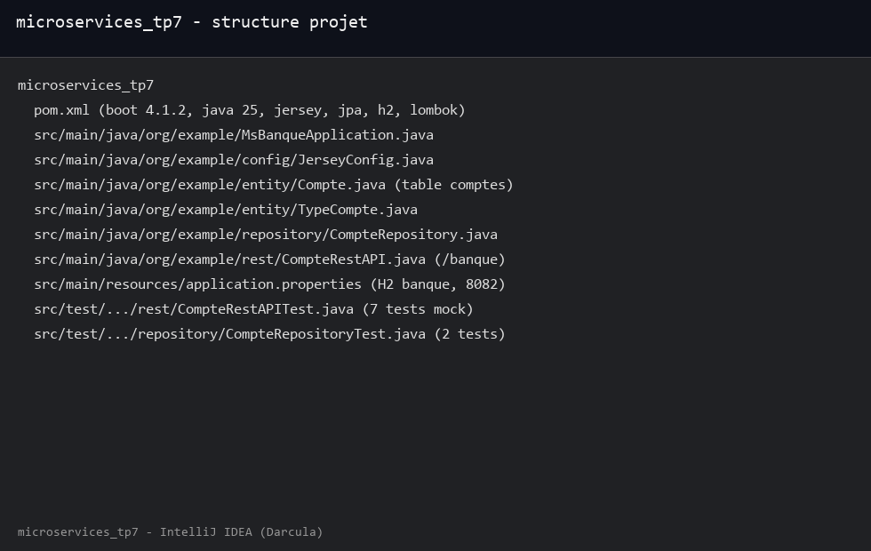
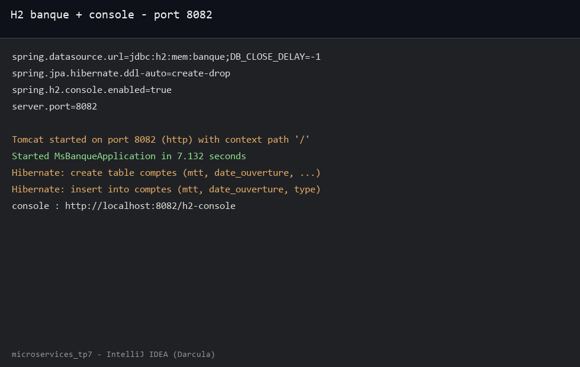
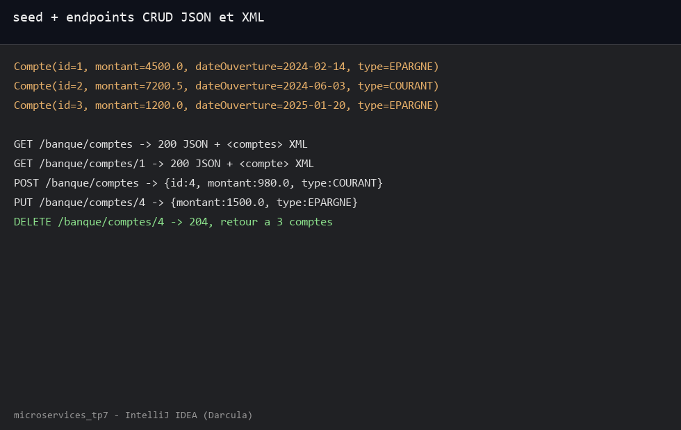
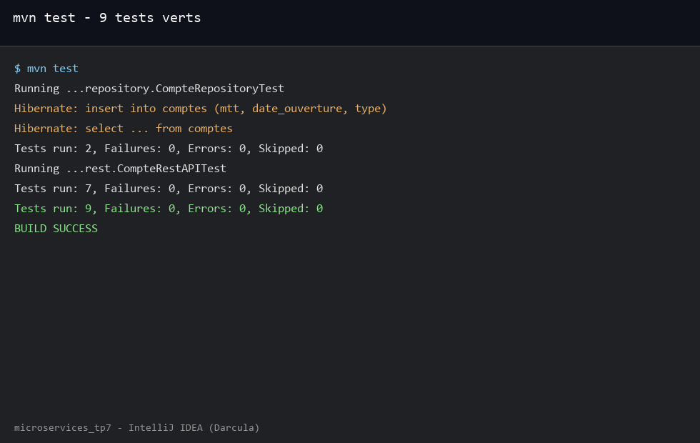
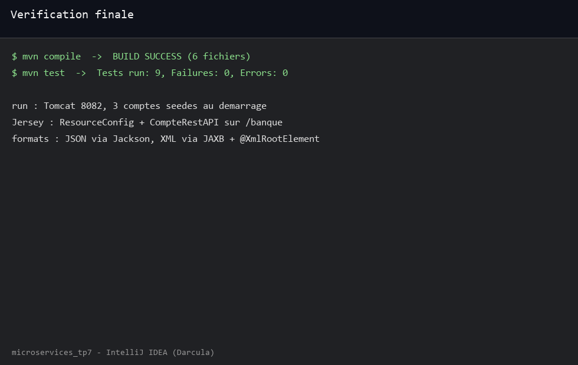

TP7 microservice banque JAX-RS avec Jersey, base H2 en memoire nommee banque sur le port 8082, entite Compte sur table comptes avec montant date d ouverture et type, enumeration COURANT EPARGNE, repository JPA, trois comptes initialises au demarrage, ressource REST CRUD sur /banque en JSON et XML, tests JUnit 5 et Mockito.

Structure du projet avec les packages org.example entity repository rest et config :

```console
src/main/java/org/example/MsBanqueApplication.java
src/main/java/org/example/config/JerseyConfig.java
src/main/java/org/example/entity/Compte.java
src/main/java/org/example/entity/TypeCompte.java
src/main/java/org/example/repository/CompteRepository.java
src/main/java/org/example/rest/CompteRestAPI.java
src/main/resources/application.properties
src/test/java/org/example/rest/CompteRestAPITest.java
src/test/java/org/example/repository/CompteRepositoryTest.java
pom.xml (boot 4.1.2, java 25, jersey, jpa, h2, lombok, jaxb)
```

Vue du projet avec l entite la ressource Jersey et les tests :



Base H2 mem banque, console activee, demarrage Tomcat sur 8082 et creation de la table comptes par Hibernate :

```console
spring.datasource.url=jdbc:h2:mem:banque;DB_CLOSE_DELAY=-1
spring.jpa.hibernate.ddl-auto=create-drop
spring.h2.console.enabled=true
server.port=8082
Tomcat started on port 8082 (http) with context path '/'
Started MsBanqueApplication in 7.132 seconds
console : http://localhost:8082/h2-console
```

Configuration H2 et logs de demarrage :



Trois comptes seedes au demarrage puis CRUD verifie en direct, liste en JSON et en XML, creation modification et suppression :

```console
Compte(id=1, montant=4500.0, dateOuverture=2024-02-14, type=EPARGNE)
Compte(id=2, montant=7200.5, dateOuverture=2024-06-03, type=COURANT)
Compte(id=3, montant=1200.0, dateOuverture=2025-01-20, type=EPARGNE)
GET /banque/comptes -> 200 JSON + <comptes> XML
GET /banque/comptes/1 -> 200 JSON + <compte> XML
POST /banque/comptes -> id 4, 980.0, COURANT
PUT /banque/comptes/4 -> 1500.0, EPARGNE
DELETE /banque/comptes/4 -> 204, retour a 3 comptes
```

Seed et endpoints testes avec curl :



Tests avec JUnit 5 et Mockito, sept tests ressource avec repository simule et deux tests repository sur H2 :

```console
Running ...repository.CompteRepositoryTest
Tests run: 2, Failures: 0, Errors: 0, Skipped: 0
Running ...rest.CompteRestAPITest
Tests run: 7, Failures: 0, Errors: 0, Skipped: 0
Tests run: 9, Failures: 0, Errors: 0, Skipped: 0
```

Resultats des tests avec les requetes condensees :



Bilan final, compile puis test puis run passent sans erreur, le XML marche grace a JAXB et @XmlRootElement, le JSON via Jackson :

```console
mvn compile -- BUILD SUCCESS
mvn test -- Tests run: 9, Failures: 0, Errors: 0, Skipped: 0
run -- Tomcat 8082, 3 comptes seedes
BUILD SUCCESS
```

Verification compile test run et formats JSON XML :


